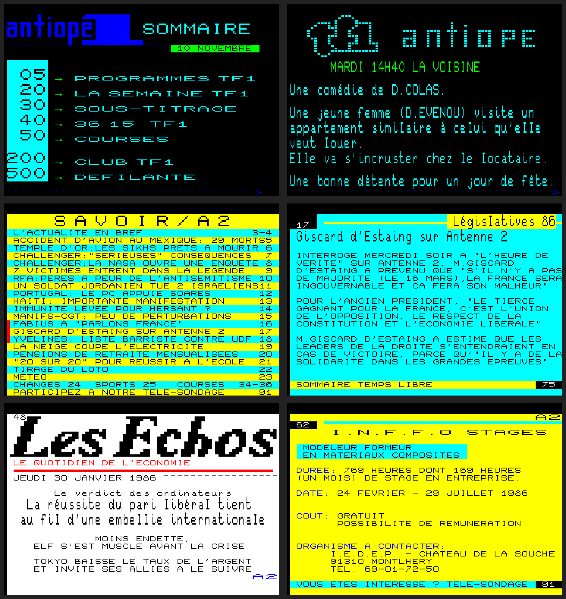
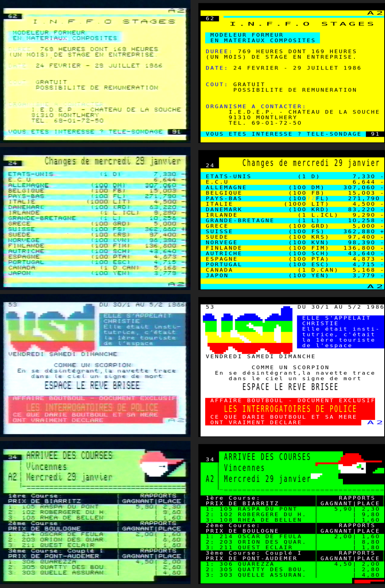

# antiope-decoder

Decoder for French **Antiope** teletext from raw VBI captures made with a
bt848/bttv card. Antiope is carried by the **Didon** packet transport
(ITU-R BT.653 / CCIR 653, teletext *system A*).

It was developed on a VHS (LP) recording of Antenne 2's *SAVOIR/A2* service
from 30 January 1986. On that tape it recovers pages 001–095 error-free.
A second recording, of TF1 from November 1986, decodes with the same code.
It carries three magazines: *Antiope 1* (channel 001), *Antiope Route*
traffic information (004) and the Météo pages (007), about 110 pages in total.



*Pages from both tapes, rendered with the bundled Benecia font.*

## Requirements

- Python 3 with numpy and scipy
- a C compiler (for the Viterbi equaliser)
- Pillow (only for `tools/palette_from_screenshots.py`)

## Usage

```bash
make                                    # builds libviterbi.so
python3 antiope_demod.py capture.vbi capture.packets.txt --jobs 12
python3 antiope_pages.py capture.packets.txt pages/
```

**Input format:** raw bttv VBI, 32 lines × 2048 samples per frame (16 lines per
field), 8 bit, sampled at 35.46895 MHz (8 × PAL fsc). A 26-minute tape
demodulates in about 1.5 minutes on 12 cores.

`antiope_demod.py` writes one line per detected Didon packet:

```
frame line quality b3 b4 ... b40      # hex bytes, b3 = framing code E7
```

`antiope_pages.py` assembles the pages and writes:

| File | Content |
| --- | --- |
| `index.html` | all pages rendered in colour with block mosaics (25 × 40) |
| `chKKK_pNNN_vV.txt` | page NNN of data channel KKK, version V, as text. The header line gives the number of receptions, the time range in the recording, lost bytes and parity errors |
| `chKKK_pNNN_vV.bin` | the corrected Antiope byte stream of the page (SOH RS … ETX EOT) |
| `chKKK_stream.bin` | the complete byte stream of each Didon channel |
| `summary.txt` | overview of all channels and pages |

Further versions of a page appear when its content changed during the
recording. A version needs at least `--min-receptions` (default 2) receptions.

## Font

`index.html` is rendered with **Benecia**, a 9 × 10 pixel font in the style of
the Antiope terminals. It is in `fonts/benecia/` (`.otf`, `.ttf` and `.woff2`,
with the original `license.txt` and `readme.txt`). The woff2 file is embedded
into `index.html` as a data URI, so the page stays a single file. It is drawn
at 18 px, where every font pixel is 2 × 2 screen pixels. Characters the font
lacks, such as arrows and frame bars, fall back to the system monospace font.
`--font PATH` selects another font file, and `--font ""` uses the system
monospace font.

> The FontStruction “Benecia” (https://fontstruct.com/fontstructions/show/2950541)
> by Monique Sammi Brie is licensed under a Creative Commons CC0 Public Domain
> Dedication license (http://creativecommons.org/publicdomain/zero/1.0/).

## Didon packet layout (system A)

| Byte | Content |
| --- | --- |
| 1–2 | clock run-in `10101010 10101010` |
| 3 | framing code `11100111` (E7) |
| 4–6 | data channel address, Hamming 8/4 |
| 7 | continuity index (mod 16), Hamming 8/4 |
| 8 | format (data block length code), Hamming 8/4 |
| 9– | data block, 7-bit bytes with odd parity, LSB first |

The bit rate is 6.203125 Mbit/s (397 × line frequency), NRZ. On the reference
tape every packet uses format B, which gives 32 data bytes and 40 bytes per line.

On the reference tape, channel `07B` carries the pages. Channel `063` carries
a status line, and `E99` on line 25 carries 8-bit binary data, probably a test
sequence.

Each channel's data stream contains Antiope data groups. A group starts with
`SOH RS` followed by a Hamming-coded record header. Its first three nibbles are
the page number, for example `0 2 8` for page 28. The group ends with `ETX EOT`.

## Signal processing

VHS LP attenuates the 3.1 MHz fundamental of the data signal by about 18 dB, so
a threshold slicer only yields noise. The demodulator does the following:

1. It takes the black level from the samples before the clock run-in, rather than from
   the line mean, which depends on the data.
2. A 3.8 MHz FIR low-pass removes noise and SECAM chroma residue above the
   data band.
3. Each line is aligned by cross-correlation with an averaged packet header
   template (`tmpl.npy`, built from this tape).
4. The data amplitude differs between recordings (the TF1 tape is about 20 %
   weaker than the A2 tape). If the default channel model finds too few
   framing codes in a chunk, it is rescaled by the measured run-in level and
   the chunk is decoded again.
5. The bit clock is nominal (5.7179 samples/bit). For each line it picks the
   best phase and clock from a small grid by Viterbi path metric.
6. Bits come from MLSE (Viterbi) equalisation. The channel model has 7 taps
   and 64 states, and its taps are re-estimated decision-directed every 250 frames.

With this, 98.3 % of the data bytes have correct parity in a single reception.
Pages are repeated about 70–90 times in the carousel. All receptions of a page
are clustered by content and combined by a per-byte majority vote, which
weights bytes with valid parity higher.

Lost packets are re-inserted as gaps using the continuity index. A channel
address with one damaged nibble is matched to a known channel. An unreadable
continuity index is taken as the previous index plus one.

## Antiope presentation layer (implemented subset)

- `US row col` positioning (row/column = byte − 0x40). Row 0 is the status row
  above the page area.
- `ESC 4/x` foreground and `ESC 5/x` background colour: black, red, green,
  yellow, blue, magenta, cyan, white
- `ESC L/M/N/O` normal, double height, double width and double size. Double
  height grows upwards into the row above.
- `ESC 5/8` and `ESC 5/F` conceal and stop conceal. Concealed text is hidden
  in `index.html` and can be revealed with a checkbox there.
- `ESC 5/9` and `ESC 5/A` contiguous and separated mosaic
- `ESC 5/C` and `ESC 5/D` normal and inverted polarity
- `SO`/`SI` for the G1 block mosaic set (2 × 3). Columns 4/5 behave like
  columns 6/7, so 5/F is a full block.
- `SS2` + accent + letter for accented characters (é, è, ç …) and some G2 symbols
- `REP` (repeat last character, including mosaics)
- G0 7/B and 7/D are thin left and right frame bars, and 7/E is an overline.

Antiope sends positioning and mode controls twice (`US r c US r c`, `SO SO`,
`ESC x ESC x`), and the decoder drops the repetition. `REP` pairs are real:
both count, otherwise the columns do not line up.

### Colours (verified against screen photos)

The colour model was checked against 45 photos of the service taken from the
same broadcast (`tools/palette_from_screenshots.py`). The tool renders each
decoded page, fits the 40 × 25 grid onto the photo and measures every colour
code. The findings:

- **Page colour from the record header.** After the page number the header
  holds groups that start with nibble `8`. The group `8 2 c` or `8 6 c`
  gives the screen background in the low 3 bits of `c`: `E` cyan, `B` yellow,
  `F` white, `A` green, `8` black. Default text is black, or white on a black page.
- **Attributes reset at every `US`.** Each positioned row starts again with the
  page colours.
- The colour codes use the standard order. The photos show faded versions of
  them, measured as median RGB of background cells:

| Code | Colour | Measured on tape | Rendered as |
| --- | --- | --- | --- |
| 0 | black | 4 30 51 | `#000` |
| 1 | red | 248 100 120 | `#f00` |
| 2 | green | 133 222 97 | `#0f0` |
| 3 | yellow | 247 255 148 | `#ff0` |
| 4 | blue | 63 138 177 | `#00f` |
| 5 | magenta | not seen | `#f0f` |
| 6 | cyan | 151 255 255 | `#0ff` |
| 7 | white | 248 255 255 | `#fff` |

Thin coloured text loses most of its colour on VHS, so blue text on yellow or
cyan looks pale in the photos. The background measurements are the reliable
ones.



```bash
python3 tools/palette_from_screenshots.py pages/ photo17.png=062 photo56.png=024 ...
```

**Known limitations:**

- Flashing and boxing are ignored.
- Black text on a black background is drawn white, as the photos show for page
  numbers.
- `tmpl.npy` and the initial channel taps were estimated from one tape. They
  are re-estimated per chunk, but very different captures may need a new
  template.

## References

- ITU-R BT.653-3, *Teletext systems*, Table 1a, system A
- US patent 4633462, which describes the Didon header layout
- US patent 4636859, *Didon digital demodulator*
